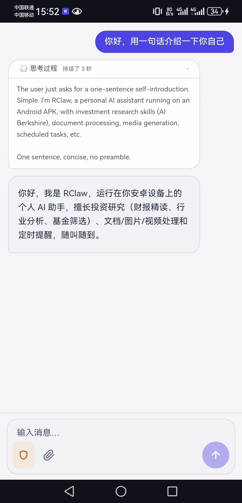

# RClaw

**Rust 实现的多通道 LLM Agent 运行时** —— 一个二进制，把 LLM 变成能在微信、QQ、控制台、桌面和安卓手机（APK / Termux）里持续工作的 Agent：ReAct 工具循环、技能系统、知识库、定时任务，开箱即用。

```
外部消息（微信 / QQ / 控制台 / 桌面 / 安卓手机） → 统一 turn 循环 → ReAct 工具调用 → 交付回复
```

## 核心特性

- **多通道并发**：控制台 CLI、桌面 GUI、微信（iLink Bot 扫码接入）、QQ（NapCat OneBot 11 over WebSocket）可同时在线，各通道独立会话与并发控制。
- **ReAct 内核**：工具批次并行执行、失败重试退避、完成闸门、用户插队与取消；超长会话自动语义压缩（CONTEXT COMPACTION + 摘要落盘）。
- **内置工具**：文件读写/编辑/列表/grep（默认沙箱在 `agent/` 目录内）、shell、联网搜索（多来源高可用池 + 熔断降级）、记忆、定时任务（cron）。
- **技能系统**：SKILL.md 激活即用，技能可声明 manifest 动态工具；仓库内置 30+ 技能（投研、OCR、图像/视频生成等），支持 Python 技能运行时与自助安装。
- **gbrain 知识库（Android APK 内置）**：进程内知识库子系统——embedding 语义检索、文档 OCR 管线、RAPTOR 递归摘要树、制品路由；数据自动落在应用私有目录。
- **模型接入**：OpenAI 兼容协议，默认智谱 GLM，可切换 DeepSeek 等任意兼容服务；流式 SSE、思考字段适配。
- **安全设计**：文件工具 fail-safe 沙箱（默认拒绝，提权需显式配置）、输出敏感信息自动脱敏（key/令牌/手机号）、每通道消息身份→权限单向链。

## Android 真机演示

https://github.com/user-attachments/assets/34940b94-c567-4844-862b-e4c987ef0356

[](docs/demo/rclaw-android-demo.mp4)

*点击封面观看完整演示（1 分 25 秒，1080p 真机录屏）：冷启动 → 新建会话 → 输入法打字发消息，看 Agent 带思考过程的流式回复 → 快速走一遍 智能体 / 工具 / 技能 / 工作区 / Agent / 自进化 / 任务概览 / 定时任务 / 配置 / 关于 全部面板 → 主题切换收尾（深色模式）。*

## 平台支持一览

| 平台 | 形态 | 说明 |
|---|---|---|
| Windows / Linux / macOS | CLI 二进制 `rclaw` | 全功能，`cargo build --release` 即得 |
| Windows | 桌面 GUI（Tauri） | 文件工作区可视化管理 + 会话/配置面板 |
| Android | 原生 APK（arm64-v8a） | Tauri Android 壳，内置 Python 技能运行时与 gbrain |
| Android | Termux CLI | 手机上直接编译运行 `rclaw`，专用低内存构建档 |

---

## 快速开始（CLI，全平台通用）

环境要求：**Rust ≥ 1.91**（rustup 安装）。TLS 全程 rustls，无 OpenSSL、无 C/C++ 依赖。

```bash
# 1. 编译（仓库根目录）
cargo build --release

# 2. 创建配置：复制示例并填入你的 API Key
cp rclaw.toml.example rclaw.toml   # Windows: copy rclaw.toml.example rclaw.toml

# 3. 启动，进入控制台对话
./target/release/rclaw             # Windows: target\release\rclaw.exe
```

最小配置只需改一处——`[[llm.providers]]` 段的 `api_key`（示例默认智谱 GLM）：

```toml
[llm]
provider = "zhipu"
stream = true

[[llm.providers]]
name = "zhipu"
base_url = "https://open.bigmodel.cn/api/paas/v4"
model = "glm-5.3-flash"
context_length = 1000000
api_key = "your-zhipu-api-key"     # ← 唯一必改项
auth = "bearer"
```

注意：配置从**当前工作目录**读取 `rclaw.toml`，在哪个目录启动就从哪里找；缺 Key 会启动期直接报错（fail-fast，刻意设计）。完整配置项（通道、搜索池、gbrain、MCP、日志、压缩阈值等）见 [`rclaw.toml.example`](rclaw.toml.example)，内含逐项注释。

常用命令：`cargo run --release -- --daemon` 后台常驻部署；会话内 `/skills` 查看技能、`/tools` 查看工具、`/search` 管理搜索源。

## 桌面版（Windows GUI）

基于 Tauri 的桌面应用（React + Vite 前端），在 CLI 全部能力之上提供图形界面：会话聊天、文件工作区管理、主配置 `rclaw.toml` 在工作区内直接编辑（带完整校验、双向同步），以及技能 / 工具 / 定时任务 / 媒体库等面板。

```bat
build-windows.cmd
```

一键完成前端构建（需 Node.js 18+）与桌面二进制编译。release 构建为 GUI 子系统（不弹控制台窗口），debug 构建保留控制台便于看日志。桌面版的 `rclaw.toml` 位于用户数据目录。

## Android APK

原生 APK（包名 `ai.rclaw.app`，arm64-v8a），在 Windows 上交叉构建：

```bat
build-android-apk.bat              :: debug APK
build-android-apk.bat release      :: release APK（本机签名）
build-android-apk-d.bat            :: 另一台机器的工具链路径包装示例
```

- **工具链**：需自备 Android 工具链（JDK 17 / SDK / NDK / Gradle），用环境变量 `ANDROID_TOOLCHAIN` 指定根目录；`RCLAW_BUILD_PYTHON` 覆盖 Chaquopy 构建用 Python。
- **内置能力**：Chaquopy 内置 Python 运行时（技能脚本可直接跑）、whisper 语音模型资产、gbrain 进程内集成（数据自动归一化到应用私有目录）；首次启动自动解包内置技能。
- **签名**：release 签名读取 `gen\android\app\rclaw-release.keystore`（不进 git）+ 环境变量 `RCLAW_KEYSTORE_PASSWORD`；二者缺任一时自动回退 debug 签名，保证全新克隆构建即可安装。
- **安装**：`adb install -r <apk>`；vivo 等对 adb 直装不自动放图标的机型，可用 `scripts/adb_install_confirm.py` 走安装器 UI 路径并自动处理确认弹窗（`RCLAW_ADB` 可指定 adb 路径）。

## Termux（手机直接跑 CLI）

在 Android 手机的 Termux 环境里从源码构建运行，无需 APK：

```bash
pkg install rust binutils git python   # python 供技能脚本使用
git clone <本仓库> && cd RClaw

# 专用低内存构建档：关 LTO、放宽 codegen-units、build script 降优化，
# 避免链接期被 OOM 杀掉；-j1 进一步限制并行内存峰值
cargo build --profile release-termux -j1

cp rclaw.toml.example rclaw.toml      # 填入 api_key
./target/release-termux/rclaw
```

注意：Termux 下保持默认 features（纯 Rust）；不要开启 ocr feature（会拉 PDFium/ONNX C 依赖）。技能的 Python 依赖建议走 venv 隔离安装。

## 外部通道接入

| 通道 | 配置段 | 要点 |
|---|---|---|
| QQ（NapCat） | `[napcat]` | OneBot 11 over WebSocket，`ws_url` 指向 NapCat；`allow_from`/`block_from` 准入，`max_from` 指定 QQ 可在私聊获得全盘文件权限（默认空=无人提权，fail-safe） |
| 微信（iLink Bot） | `[weixin]` | `token` 填 iLink Bot 凭据，扫码登录后收发消息与媒体 |
| 控制台 | 内置 | 无需配置，随二进制启动 |

媒体（图片/语音/文件）自动落盘 `agent/media/`；出站媒体须落在 media 沙箱内。

## API Key 配置清单

所有配置（含密钥）集中从文件读取，不走环境变量。需要填 Key 的位置如下：

### 主配置 `rclaw.toml`（复制自 `rclaw.toml.example`）

| 配置段 | 字段 | 用途 | 何时需要 |
|---|---|---|---|
| `[[llm.providers]]` | `api_key` | LLM 主推理（示例默认智谱 GLM） | **必填**，缺 Key 启动期直接报错 |
| `[web_search.doubao_custom]` / `[web_search.tavily]` / `[web_search.zhipu]` / `[web_search.doubao_global]` | `api_key` / `api_keys` | 联网搜索池各来源（Tavily 支持多 Key 自动切换） | 启用 `[web_search]` 后按启用的来源填 |
| `[weixin]` | `token` | 微信 iLink Bot 通道凭据 | 启用微信通道时必填 |
| `[napcat]` | `access_token` | QQ 通道鉴权（与 NapCat 配置一致；留空 = 不鉴权） | 可选 |
| `[mcp.servers.gbrain.env]` | `GBRAIN_EMBEDDING_API_KEY`、`GBRAIN_EXPANSION_API_KEY`、`GBRAIN_CHUNKER_API_KEY`、`GBRAIN_KB_RAPTOR_API_KEY`、`GBRAIN_TRANSCRIPTION_GROQ_API_KEY` / `GBRAIN_TRANSCRIPTION_OPENAI_API_KEY`、`GBRAIN_OCR_API_KEY` | gbrain 知识库各环节（embedding / 扩展 / 分块 / RAPTOR 摘要 / 语音转写 / OCR） | 启用 gbrain 时按需 |
| `[mcp.servers.<金融 MCP>]` | `headers.Authorization` + `headers.X-Bigmodel-Authorization` | ZCode 金融 MCP 双头鉴权（同花顺 / Wind 数据轨） | 可选；真实令牌可用 `scripts/zcode_tokens.py --write` 从本机凭据提取回写 |

### 技能 Key 文件（`skills/` 下，均为空值模板）

| 文件 | 字段 | 用途 |
|---|---|---|
| `skills/glm-master-skill/config.toml` | `[zhipu].api_key` | 一份 Key 供全部 GLM 技能（OCR / 视觉理解 / 图像生成）共用 |
| `skills/glmv-stock-analyst/config.toml` | `api_key` + `tushare_token` | 股票分析技能的多模态模型 Key 与 tushare 数据 token |
| `skills/ark_key.toml` | `[ark].api_key` | 火山方舟（Seedance / Seedream）生成技能 |
| `skills/happyhorse_key.toml` | `[happyhorse].api_key` | 阿里百炼（HappyHorse）视频生成技能 |

Key 均为本地文件填写，勿提交真实值进仓库；`rclaw.toml.example` 与技能 Key 模板在仓库中保持空占位。

## 内置技能（skills/ 目录）

`skills/` 内置 28 个独立技能 + 4 个多子技能投研包，开箱即用。技能目录每轮只以 title + 60 字符截断描述进系统提示（渐进披露），模型按需读取对应 `SKILL.md` 后才激活其工具。

### 智谱 GLM 官方技能族（16 个，移植自 zai-org/GLM-skills）

| 技能 | 用途 |
|---|---|
| `glm-master-skill` | GLM 技能总路由与运行规范：附件意图门禁、统一配置读取、能力分诊。只路由不调 API |
| `glmocr` | GLM-OCR 通用文字识别（图片 / PDF） |
| `glmocr-table` | 表格识别，输出 Markdown |
| `glmocr-formula` | 数学公式识别，输出 LaTeX |
| `glmocr-handwriting` | 手写文字识别 |
| `glmocr-sdk` | GLM-OCR SDK 批量解析（Markdown + 结构化 JSON） |
| `glm5v-multimodal` | GLM-5V-Turbo 通用多模态分析：视觉问答、多图对比、图表 / 文档问答、自定义结构化提取 |
| `glmv-caption` | 图片 / 视频 / 文档内容描述与摘要 |
| `glmv-doc-based-writing` | 基于文档写作：读入 PDF/DOCX 按要求产出 Markdown 文章 |
| `glmv-pdf-to-ppt` | PDF 转结构化 PowerPoint 演示文稿 |
| `glmv-pdf-to-web` | PDF 转单页学术 / 项目网站 |
| `glmv-prompt-gen` | 从图片 / 视频反推专业提示词（Midjourney、SD 等） |
| `glmv-resume-screen` | 多简历批量筛选，输出 Markdown 对比表 |
| `glmv-stock-analyst` | 股票多维综合分析（港股 / A 股 / 美股），产出图文报告 |
| `glm-image-gen` | GLM-Image 文生图（科学插画、人像、海报） |
| `glm-quota-query` | 查询智谱 GLM API 实时额度与用量 |

### 视频 / 图像生成（7 个）

| 技能 | 用途 |
|---|---|
| `seedance-video` | 火山方舟 Seedance 2.5 视频生成与编辑（文生视频、首尾帧、全参考生成、编辑、续写） |
| `sd25-pe` | Seedance 2.5 官方提示词工程：粗文案编译为可提交 prompt |
| `seedream-image` | Seedream 5.0 lite 图片生成 / 编辑 / 多图融合 / 组图 / 联网搜索 |
| `seedream-prompt-gen` | Seedream 图片提示词写作 |
| `happyhorse-t2v` | 阿里百炼 HappyHorse 文生视频（3–15s） |
| `happyhorse-i2v` | HappyHorse 图生视频（首帧驱动） |
| `happyhorse-r2v` | HappyHorse 参考图生视频（1–9 张参考图控主体 / 风格） |

### 投研 / 金融（4 个技能 + 4 个技能包）

| 技能 / 包 | 用途 |
|---|---|
| `ai-berkshire`（包） | 四大师价值投资研究包：23 个子技能（investment-research、investment-team 交叉质询、earnings-review、industry-funnel、quality-screen、thesis-tracker 等）+ A 股行情 / 财务 / 估值数据入口 |
| `evaluate-fund` | 公募基金 / ETF / FOF / QDII / REIT 系统评估与持仓分析，产出 Markdown / 自包含 HTML 报告 |
| `screen-funds` | 全市场基金候选池构建：硬过滤 + 分类评分 + 稳健性检查的漏斗筛选 |
| `analyze-gold-market` | 人民币金价与黄金行情评估，情景化操作计划（不代客下单） |
| `pick-funds`（包） | 基金研究包：fund-profile / fund-screen / fund-watch / holdings-style / manager-profile 五个子技能，配 ZCode 金融 MCP 数据轨 |
| `read-macro`（包） | 宏观与策略包：宏观仪表盘、指数估值分位、资产配置、政策跟踪 |
| `watch-positions`（包） | 持仓监控包：盘中快照、盘后复盘、事件监控、自选股管理 |

### 工具类（2 个）

| 技能 | 用途 |
|---|---|
| `extract-archive` | 解压 zip / tar 全家桶与单文件 .gz/.bz2/.xz，自动防 zip-slip、修 Windows 中文乱码 |
| `cron-task-patterns` | 定时任务的书写模式与范例 |

生成类技能需要各自平台的 API Key，文件与字段见上文「[API Key 配置清单](#api-key-配置清单)」。

## 技能工具的设计：Manifest 动态工具

技能脚本不通过 `shell` 拼命令调用，而是由 `skill.toml` 声明式 Manifest 编译成**结构化动态工具**，模型读取 `SKILL.md` 后该技能的入口以 `skill__<skill>__<entrypoint>` 形式变为可调用工具（激活生命周期：未激活 → 已激活 → 技能被编辑时失效 → 下一轮重置）。

一个最小 Manifest 示例（摘自 `ai-berkshire`）：

```toml
[[entrypoints]]
name = "ashare-quote"
description = "查询 A 股实时行情。"
runtime = "python"
script = "tools/ashare_data.py"
fixed_args = ["quote"]          # 固定子命令，模型不可见不可改

[[entrypoints.arguments]]
name = "code"
type = "string"
description = "股票代码，例如 600519。"
required = true
position = 0                    # 位置参数；也可用 flag = "--type" 声明具名参数
```

参数类型系统支持 `string` / `integer` / `number` / `enum`（取值白名单）/ `path`（可配 `must_exist`），每个参数带 required 与描述。执行时运行时直接构造参数数组启动进程，**不经过 shell**，也不允许模型拼接脚本路径或命令行。

这套设计针对 LLM 工具调用的真实失败模式：

1. **防幻觉传错参数**——`enum` 参数只能取清单内的值、类型不符在调用前直接拒绝，错误信息自描述（缺什么、合法值是什么），模型能在同一轮自行纠正；而不是把错误参数传进脚本、在运行深处炸出一个难解读的 traceback。脚本路径、子命令由 `script` + `fixed_args` 固定，模型根本接触不到"调哪个脚本"这个自由度，从源头消灭路径幻觉与命令拼接幻觉。
2. **防命令注入**——参数以 argv 数组直达进程，不存在 shell 解释层，模型写不出 `; rm -rf` 这类注入语法。
3. **防路径逃逸**——`path` 参数按工作区解析相对路径，拒绝越界绝对路径与 `../` 父目录跳转；`must_exist` 在启动前校验文件存在。
4. **防 Key 泄漏**——Key 集中在共享 TOML 配置，动态工具不开放配置路径参数；Key 不出现在 SKILL.md、命令行、输出与日志里。
5. **输出有界且自描述**——stdout/stderr 各自 64 KiB 截断并携带 `输出截断` 标志；规范要求大产物落文件、stdout 只回摘要 + 路径，模型经 `read` 分页取。
6. **媒体交付可信**——`publishes_media = true` 声明的入口产出的媒体标记必须经媒体认领闸门验证，未验证的标记会让 turn 无法宣称完成，杜绝"口头交付"。
7. **工具面按需出现**——未激活的技能工具不在 schema 里，几十个技能不会把系统提示与工具 schema 撑爆，也降低误调用。

技能之上还有一层**自进化治理**：每轮结束对读取过入口的技能按整轮成败记账（索引行显示"近N次：X成Y败"）；curator 后台按可靠性 + 闲置时长做 Active → Stale → Archived 生命周期维护（仅动 agent 自建技能，pinned / 仓库技能不碰）；新鲜经验先进 `EXPERIENCE.md` 热经验层，被证明稳定后才固化进 SKILL.md；每次技能写入前 capture sha256 台账，可逐变更回滚；写入路径带隐形字符拒绝与密钥自动脱敏扫描。

## 内置工具

agent 每轮可用的工具面（技能动态工具与 MCP 工具之外）：

### 文件

| 工具 | 说明 |
|---|---|
| `read` / `write` / `edit` / `delete` | 工作区文件读写、精确替换编辑、删除（默认沙箱在 `agent/` 目录内） |
| `list` / `grep` | 目录列举与正则内容检索 |

### 执行

| 工具 | 说明 |
|---|---|
| `shell` | 执行 shell 命令（当前目录为 agent 工作区；通道权限可约束到目录外路径的访问） |
| `shell_poll` | 轮询 / 收割后台 shell 任务，长任务不阻塞 turn |

### 记忆与检索

| 工具 | 说明 |
|---|---|
| `memory` | 操作 MEMORY.md / USER.md：list / add / replace / remove / batch，预算制上限 + 写入脱敏 |
| `session_search` | 跨会话（含归档会话）关键词检索，AND 语义 + 词频计分，召回"上次那个问题怎么解决的" |
| `web_search` | 多来源高可用搜索池（豆包 Custom / Tavily 多 Key / 智谱 MCP / 豆包 Global），额度与熔断自动切换，可补读正文 |
| `web_browser` | 浏览器式网页抓取与阅读；检索引擎可配置（`[web_browser].engine` 或 `/webbrowser`，google/bing/baidu，搜不到自动依次换备用引擎，备选顺序 必应→百度） |
| `tavily_extract` | Tavily 正文抽取 |

### 技能管理

| 工具 | 说明 |
|---|---|
| `skills_list` / `read`（skill 域） | 列出 / 读取技能档案 |
| `skill_manage` | 创建 / 编辑 / 回滚技能，受 read-before-write、所有权门、pinned 保护与写入扫描约束 |

### 定时与自动化

| 工具 | 说明 |
|---|---|
| `cron_add` / `cron_list` / `cron_remove` | 定时任务的增删查，任务本身走完整 turn 循环 |

### 多智能体协作

| 工具 | 说明 |
|---|---|
| `Agent` | 子代理委派（目标式 / 契约式两档，带拆分理由门控） |
| `TeamCreate` / `TeamDelete` / `TaskCreate` / `TaskUpdate` / `TaskList` / `TaskGet` / `SendMessage` | 团队协作：共享任务表 + 成员邮箱 |
| `AgentStatus` / `AgentCancel` / `AgentWait` / `AgentResume` | 子代理生命周期管理 |
| `PlanRun` | 依赖序多步计划：JSON 步骤表 + 并行波次执行 + 逐步事件日志 |
| `message_agent` | bot 间交接：带不可伪造交接链的消息投递（深度上限 3，防环路） |

### 扩展

| 工具 | 说明 |
|---|---|
| MCP `<server>__<tool>` | 在 `[mcp]` 段配置的任意 MCP server（stdio / streamable-http），工具自动注册，与内置工具同面调用 |

## Workspace 布局

```
crates/
├── rclaw-core        消息总线与领域类型（无环依赖规则的根）
├── rclaw-store       会话/记忆持久化 + 敏感信息 redact
├── rclaw-llm         Provider 两层抽象（协议层 + 方言层）、SSE 流式解析
├── rclaw-tools       内置工具与技能运行时
├── rclaw-gbrain      知识库子系统（embedding/OCR/RAPTOR/KB；lib-only，仅 APK 进程内集成）
├── rclaw-channels    外部通道适配（napcat/weixin/console）
├── rclaw-runtime     AgentLoop、TurnManager、ReAct 内核
├── rclaw-cli         唯一可执行目标：rclaw 二进制
├── rclaw-desktop     三态 crate：桌面 Tauri GUI / Termux 提示桩 / APK 宿主(apk-host)
├── rclaw-android     Android 桥接（GUI 装配、浏览器、bridge executor）
└── rclaw-weixin-login 微信扫码登录
```

开发：`cargo test`（默认桌面九 crate）、`cargo check --workspace`；Android 相关 crate 经 `apk-host` feature 链路进入 APK 构建。

## 致谢

RClaw 站在开源社区的肩膀上——从起源项目到同类 agent 的机制借鉴：

- **[CClaw](https://github.com/sky6776/CClaw)**——RClaw 最初是 CClaw 的 Rust 实现，后续逐步扩展为独立的多通道自进化 agent 运行时。
- **[Hermes Agent](https://github.com/NousResearch/hermes-agent)**（NousResearch）——同谱系的自进化 agent。RClaw 的自进化体系（后台评审、记忆 / 技能 review、curator 策展），以及跨会话检索、评审成本控制（token 预算 + digest 重放）、技能 sha256 台账回滚、记忆加载期复扫与漂移检测等机制，均借鉴自 Hermes。
- **[Blockcell](https://github.com/blockcell-labs/blockcell)**（blockcell-labs）——Rust 构建的 agent 框架，RClaw 的 NapCat（QQ 通道）实现借鉴自该项目。
- **[ai-berkshire](https://github.com/xbtlin/ai-berkshire)**（xbtlin）——`skills/ai-berkshire` 投研技能包从该 Claude Code 仓库修改适配而来，四大师价值投资研究法的原始出处。
- **[GLM-skills](https://github.com/zai-org/GLM-skills)**（zai-org / 智谱）——本仓库 16 个 GLM 官方技能（OCR / 视觉 / 图像生成族）移植自此，并针对 RClaw 的 workspace 路径、共享 TOML 配置与按需交付做了适配。
- **OpenClaw 生态与 Anthropic 的技能目录设计**——渐进披露与技能描述三段式（Use when / Do NOT use / 前置成本）的设计来源。
- **[whisper.cpp](https://github.com/ggml-org/whisper.cpp)**——`third_party/` 内置，为语音消息提供本地 ASR。

## License

[MIT](LICENSE)
